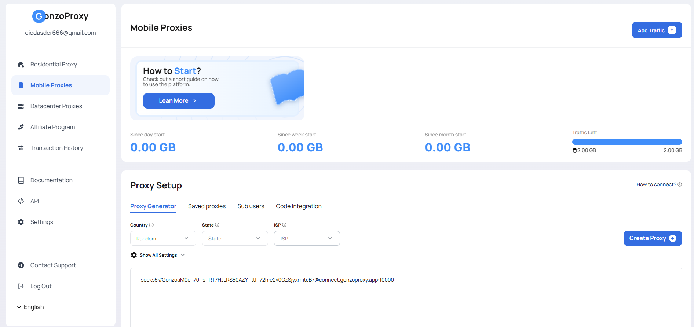

# 📱 Мобильные прокси GonzoProxy

### 📲 Что такое мобильные прокси?

<figure><figcaption></figcaption></figure>

Мобильные прокси это IP-адреса, которые операторы сотовой связи выдают своим абонентам. Запрос, отправленный через такой адрес, приходит на сайт с адреса оператора.

Мобильный пул один из трёх пулов аккаунта, рядом с резидентским и серверным. Один аккаунт, один шлюз и один вид логина работают для всех трёх.

***

### 🔌 Подключение

* Шлюз: `connect.gonzoproxy.app:10000`
* На этом порту работают протоколы HTTP, HTTPS (настоящий TLS до прокси) и SOCKS5
* SOCKS4 и SOCKS4a не работают

Строку подключения вставьте в поле прокси того инструмента, в котором работаете. Чаще всего клиенты называют Octo Browser, затем в равной мере Dolphin Anty и AdsPower, затем curl и Python requests.

***

### 🌍 Выбор страны

В селекторе стран мобильного пула было 134 страны, когда мы смотрели кабинет 14 сентября 2026 года. Это количество стран в списке, а не количество адресов.

Кроме страны можно выбрать регион и оператора, выбор записывается в строку подключения. Выбора города у мобильного пула нет.

***

### 🔁 Ротация

Доступны три режима:

* **Случайный IP**: адрес меняется при каждом обращении
* **Один IP на срок**: адрес держится в течение сессии, до 72 часов. Если устройство отключилось, система выдаёт новый IP
* **IP не меняется**: адрес сам не меняется в пределах сессии, до 72 часов. Если устройство уйдёт из сети, прокси перестанет работать: автоматической смены IP не будет. Чтобы продолжить, создайте новый прокси. В логине стоит суффикс `_iphold_max`

Сессию длиннее 72 часов генератор выставить не даёт. Примеры строки подключения для каждого режима на странице [Ротация IP](rotaciya-ip.md).

Вот что мы измерили в режиме «Один IP на срок» на собственном аккаунте 14 сентября 2026 года. На горизонте 84 минуты тот же IP сохранила 51 сессия из 90, это 56,7% с доверительным интервалом от 46,4% до 66,4%. Половина потерь пришлась на первые 35 минут. Отдельно по мобильному пулу вышло 53,3%, но интервалы по пулам пересекаются, поэтому мы не утверждаем, что какой-то пул держит адрес лучше другого.

В отдельном прогоне с 7 по 10 сентября 2026 года одна сессия сменила IP три раза за первые 2,5 часа, а потом держала один адрес около 69 часов. Это одна сессия и доказательство возможности, а не частота, на которую стоит рассчитывать.

Объём работы в этом режиме планируйте от измеренного: адрес сохраняют 56,7% сессий (51 из 90) к 84-й минуте, поэтому на каждую нужную живую сессию открывают примерно 1,8 сессии, а по нижней границе 46,4% примерно 2,2.

***

### ⏱️ Скорость

В том же прогоне 14 сентября 2026 года медианное время ответа мобильного пула составило 1,60 с против 1,33 с у резидентского и 1,44 с у серверного. Это медианы одного прогона, интервалы для них мы не публикуем. Там, где скорость запроса важнее типа адреса, лучше подходят резидентский или серверный пул.

***

### 💳 Трафик и оплата

* Трафик оплачивается за гигабайт. У мобильного пула своя цена за гигабайт и свой баланс (**Traffic Left**), другие пулы его не расходуют. Цена зависит от объёма покупки и показана при пополнении в разделе **Mobile Proxies**.
* Оплата проходит через Cryptomus, в криптовалюте. Оплата картой не работает с июля 2026 года.
* Трафик не сгорает: купленные гигабайты остаются на балансе, пока вы их не израсходуете.

***

### ⚠️ Чего в продукте пока нет

* Нет статистики расхода по портам, по гео и по субаккаунтам.
* Работающий прокси не доказывает, что баланс пополнен: при нулевом балансе прошли 35 запросов из 36.
* При достижении лимита соединение закрывается молча: TCP принимается и сразу закрывается без ответа SOCKS5. В нашем прогоне соединения заработали примерно через 25 минут.

***

### 👾 Попробовать можно здесь: [GonzoProxy.com](https://gonzoproxy.com)

***

### 📱 Мы на связи

* [Telegram-канал ](https://t.me/GonzoProxy)
* [Telegram-чат ](https://t.me/GonzoProxy_Chat)
* [Instagram](https://www.instagram.com/gonzoproxy)
* [Поддержка 24/7 ](https://t.me/GonzoProxy_bot)

💬 Наша команда всегда на связи! Обращайтесь в любое время суток.
